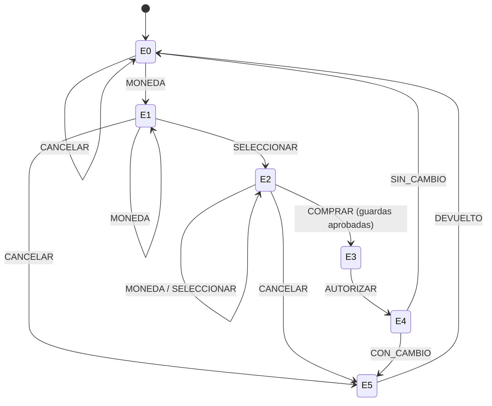

# Autómata finito de la máquina expendedora

Autor: Jesser Cetino. Clase principal: `vending.automata.AutomataFinito` (implementa `ControlEstados`).

### Estados

| Estado | Descripción |
|---|---|
| E0 | Esperando dinero |
| E1 | Dinero ingresado |
| E2 | Producto seleccionado |
| E3 | Procesando compra |
| E4 | Entregando producto |
| E5 | Devolviendo dinero |

### Tabla de transiciones

| Desde | Evento | Hacia |
|---|---|---|
| E0 | MONEDA | E1 |
| E0 | CANCELAR | E0 |
| E1 | MONEDA | E1 |
| E1 | SELECCIONAR | E2 |
| E1 | CANCELAR | E5 |
| E2 | MONEDA | E2 |
| E2 | SELECCIONAR | E2 |
| E2 | COMPRAR | E3 |
| E2 | CANCELAR | E5 |
| E3 | AUTORIZAR | E4 |
| E4 | CON_CAMBIO | E5 |
| E4 | SIN_CAMBIO | E0 |
| E5 | DEVUELTO | E0 |

No se inventan estados de error. Si una operación no pasa las validaciones semánticas, la lógica **no envía** el evento y el estado se mantiene.

### Diagrama de estados (Mermaid)



```java
import vending.automata.AutomataFinito;
import vending.automata.Entrada;

AutomataFinito automata = new AutomataFinito();

// Tras validar en la lógica que valor == 1, 5 o 10:
automata.transitar(Entrada.MONEDA);

// Tras validar que el artículo existe y tiene existencias:
automata.transitar(Entrada.SELECCIONAR);

// Tras validar selección, saldo suficiente y existencias:
automata.transitar(Entrada.COMPRAR);  // E2 -> E3
automata.transitar(Entrada.AUTORIZAR); // E3 -> E4

// Tras realizar el despacho y descontar una unidad (una sola vez):
if (cambio > 0) {
    automata.transitar(Entrada.CON_CAMBIO); // E4 -> E5
    automata.transitar(Entrada.DEVUELTO);   // E5 -> E0
} else {
    automata.transitar(Entrada.SIN_CAMBIO); // E4 -> E0
}
```

La GUI puede recuperar los datos de estado así, **sin cambiar `VendingViewModel`**:

```java
String codigoEstado = automata.getCodigoEstado();
String descripcionEstado = automata.getDescripcionEstado();
// Pasar estas cadenas como stateCode y stateDescription al VendingViewModel.
```

Un observador puede mostrar transiciones intermedias E3/E4/E5 en un historial de resultados:

```java
automata.agregarObservador(paso -> System.out.println(paso));
```

El controlador debe refrescar el modelo final en E0. Los estados E3, E4 y E5 pueden ser transitorios (rápidos); mostrarlos durante la operación requiere que el controlador publique cada transición o su historial. El autómata sí los recorre y los registra.

### Validaciones que deben realizar otros módulos

- `MONEDA(100)`: la lógica rechaza antes de llamar `transitar(MONEDA)`.
- `SELECCIONAR` sin dinero: E0 no permite seleccionar.
- Producto inexistente/sin stock: la lógica rechaza; E1 permanece en E1.
- `COMPRAR` sin selección: en E0/E1 no existe la transición.
- Saldo Q5 y precio Q8: la lógica rechaza; E2 queda sin cambios. Puede entrar otra moneda en E2 y volver a comprar.
- Venta válida: el backend descuenta exactamente una unidad y devuelve cambio; al terminar E0.
- Segundo `COMPRAR()` después de venta: E0 no admite COMPRAR; no puede producir una segunda entrega.
- `CANCELAR()`: si hay dinero, E1/E2 -> E5 -> E0, devolviendo saldo y limpiando selección; sin dinero E0 -> E0.
- `MOSTRAR`, `PRODUCTO` y `CARGAR`: no generan transiciones; el inventario y el parser los atienden.
- JSON: para restaurar una operación válida, el componente JSON valida saldo/selección, invoca `reiniciar()`, después reproduce MONEDA si saldo positivo y SELECCIONAR si existe selección; **no** posiciona el estado arbitrariamente.

## Evidencia con ejemplos del PDF

- **Exitoso (dos MONEDA, SELECCIONAR, COMPRAR, cambio)**: `E0 -> E1 -> E1 -> E2 -> E3 -> E4 -> E5 -> E0`.
- **Sin existencias**: después de dos MONEDA sigue `E1`; una selección rechazada no cambia el estado; CANCELAR recorre `E1 -> E5 -> E0`.
- **Saldo insuficiente**: `E0 -> E1 -> E2`; COMPRAR rechazado conserva `E2`; MONEDA vuelve a `E2`, y una compra autorizada termina en `E0`.
- **Sin cambio**: `E2 -> E3 -> E4 -> E0`.

